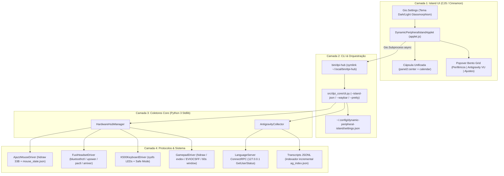
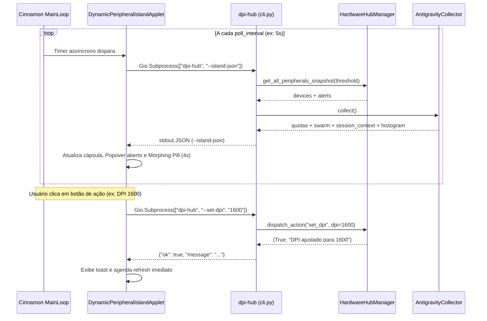

# Arquitetura Técnica (`docs/ARCHITECTURE.md`)

Este documento detalha a arquitetura em camadas do **Dynamic Peripheral Island**, seus fluxos de dados, protocolos de comunicação e ciclo de vida do Applet Cinnamon.

---

## 1. Visão Geral em Camadas

O sistema é dividido em 4 camadas desacopladas com fluxo unidirecional de telemetria e despacho explícito de comandos:

---

## 2. Sequência de Atualização Assíncrona e Controles

---

## 3. Detalhamento dos Protocolos de Hardware (`src/dpi_core/hardware.py`)

### 3.1. Mouse AJAZZ AJ179 V2 (`AjazzMouseDriver`)
- **Identificação**: VID `249a`, PID `5c2f` (e família `248a:*`) em `/sys/class/hidraw`.
- **Protocolo HID 33 bytes**:
  - `build_packet(cmd, write=False, payload=b"")` monta `0x00` (Report ID) + frame de 32 bytes:
    - `buf[0] = cmd`
    - `buf[2] = 0x01` (escrita) ou `0x00` (leitura)
    - `buf[3] = len(payload)`
    - `buf[4:4+len] = payload`
    - `buf[31] = sum(buf[4:31]) & 0xFF`
  - `verify_checksum(frame32)` valida `frame32[31] == sum(frame32[4:31]) & 0xFF`.
- **Deep Sleep Cache (PAW3395)**: Quando o dongle retorna NACK (`0xFF`) ou resposta vazia por economia de energia, o driver lê `~/.config/dynamic-peripheral-island/mouse_state.json`, mantendo os últimos valores válidos com `standby=True` e `cached=True`.

### 3.2. Headset Havit Fuxi H3 (`FuxiHeadsetDriver`)
- **Detecção Dual**:
  - **Bluetooth**: consulta `bluetoothctl info 01:92:25:27:09:76`, `upower` e `/sys/class/power_supply` para bateria e status conectado.
  - **Dongle 2.4GHz (`040b:0897`)**: varre `hidraw` e cards ALSA/PulseAudio (`pactl list cards`, `pactl list sinks`) com `LC_ALL=C`.
- **Bug ALSA `numid=9`**: Detecta volume zerado no card `FuxiH3` (`alsa_zero_bug=True`) e corrige via `amixer -c FuxiH3 cset numid=9 100,100` e `numid=7 on` (`fix_alsa_volume()`).
- **Sidetone e EQ**: Sidetone gerenciado via `pw-loopback`; presets (`gaming`, `music`, `voice`, `flat`) persistidos e aplicados via `pactl`.

### 3.3. Teclado Machenike K500-B94 (`K500KeyboardDriver`) — Hardware Safe Mode
- **Restrição Crítica**: Controlador Sino Wealth (`258a:0049`).
- `validate_hid_frame(frame: bytes)` aceita apenas tamanhos `{8, 16, 32, 33, 64, 65}` e rejeita (`ValueError`) frames vazios ou compostos apenas por `0x00`.
- `send_raw_packet(frame: bytes)` lança `RuntimeError` incondicionalmente enquanto `safe_mode=True`.
- `read_state()` lê apenas `/sys/class/leds/input*::*` (`capslock`, `numlock`, `scrolllock`) e expõe o guia de atalhos físicos `FN`.

### 3.4. Gamepads (`GamepadDriver`)
- **GameSir Nova Lite (`3537:1041` / `3537:2106`) & EasySMX 9124 (`045e:028e`)**:
  - Varre `/sys/class/hidraw`, `/proc/bus/input/devices` e `/sys/class/power_supply`.
  - **Consolidação**: Dois nós `045e:028e` (cabo USB-C + dongle 2.4GHz) são fundidos em um único controle com `charging=True` e `connection_type="USB-C (Carregando) + Dongle 2.4GHz"`.
  - **Janela de Atividade (60s)**: Monitoramento não-bloqueante via `select.select(..., 0)` + timestamp em `/tmp/dpi-gamepad-<event>.active` validado por `is_activity_fresh(last_ts, now_ts, window=60.0)`.
  - **Force Feedback (`test_rumble`)**: Envia estrutura `ff_effect` de 48 bytes via `fcntl.ioctl(fd, EVIOCSFF, ...)`. Se o kernel retornar `errno.ENOSYS (38)` (modo DInput), retorna instrução para alternar para XInput (`M + Menu + View` por 2s).

---

## 4. Coletor Antigravity (`src/dpi_core/antigravity.py`)

1. **Descoberta do Daemon**: Lê `~/.gemini/antigravity/daemon/hub_*.json`, valida se `/proc/<pid>` corresponde a `language_server` e utiliza `/proc/*/cmdline` (`--csrf_token`) como fallback.
2. **ConnectRPC**: `POST http://127.0.0.1:<httpPort>/exa.language_server_pb.LanguageServerService/GetUserStatus` com header `x-codeium-csrf-token` e timeout de `1.5s`.
3. **Modelo Ativo & Cotas**:
   - Lê `last_selected_agent_model` em `~/.gemini/antigravity/antigravity_state.pbtxt` e traduz via `MODEL_ID_MAP`.
   - Agrupa `clientModelConfigs` em `neon`, `hydrogen`, `argon`, `flash`, `claude_gpt`, `carbon` e grupos futuros dinâmicos (`infer_model_group`).
   - Calcula `remaining_pct`, `used_pct`, `reset_countdown`, `pace_pct` (fração decorrida da janela `5h` ou `7d`) e `depletion_eta`.
4. **Indexador Incremental**: Lê apenas arquivos `transcript.jsonl` cujo `(mtime_ns, size)` mudou em relação ao índice `~/.cache/dynamic-peripheral-island/ag_index.json`, mantendo o tempo de resposta em poucos milissegundos.

---

## 5. Ciclo de Vida do Applet Cinnamon (`applet.js`)

- **`_init`**: Cria a estrutura da cápsula (`.dpi-capsule-content`), segmentos clicáveis de Periféricos e Antigravity, Morphing Alert Pill (`.dpi-alert-pill`), Popover Bento Grid e listeners de `Gio.Settings` para tema adaptativo.
- **`on_applet_added_to_panel`**:
  - Integra-se ao `this.panel._centerBox` aplicando `.dpi-unified-capsule` e harmonizando o irmão `calendar@cinnamon.org` (`.dpi-capsule-clock`), ou usa `.dpi-standalone-capsule` como fallback.
  - Registra o atalho global `dpi-toggle-island` (`<Super><Alt>i`) via `Main.keybindingManager.addHotKey`.
  - Inicia o loop de polling assíncrono (`Mainloop.timeout_add_seconds`).
- **`on_applet_removed_from_panel`**:
  - Cancela timers pendentes, remove o hotkey `dpi-toggle-island`, desconecta sinais do `Gio.Settings` e restaura as classes originais de `this.panel._centerBox` e `calendar@cinnamon.org` sem deixar resíduos no painel.
